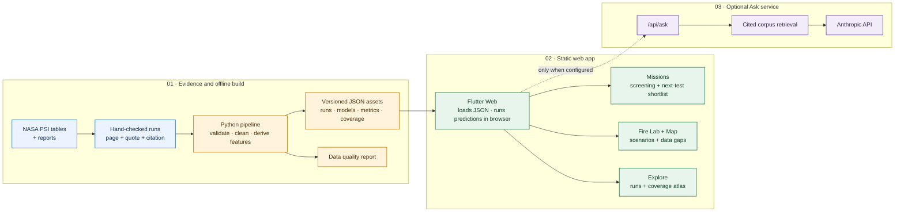

# FlameSense: Presentation Guide

Everything the team needs to understand FlameSense, use every page, and present it to judges.
Live site: **https://flamesense.ehsanur.com** · Judge tour: **https://flamesense.ehsanur.com/?tour=1**

> FlameSense is a research and education tool. It is not a certified fire-safety system and must
> not be used for operational safety decisions. Not affiliated with or endorsed by NASA.

---

## 1. The one-minute pitch

The challenge statement says the Moon base will likely use **30% oxygen or more at 10.2 psi or less**;
NASA recommends **34% oxygen at 8.2 psia (56.5 kPa)** (NTRS 20240003211), a richer,
thinner atmosphere than the space station (21% at 101 kPa). Fire behaves differently there, and
NASA's own studies call material flammability the hardest problem at that atmosphere.

**FlameSense takes NASA's microgravity fire experiments, puts every test run in one place with
its source, learns from them where a flame keeps burning, and shows exactly where the data runs
out, so NASA knows which fire test to run next.**

Three things to remember:
1. **Real data only.** 123 test runs, every one traceable to a page in a NASA report or a labelled paper.
2. **Honest predictions.** Every prediction shows how much real data supports it.
3. **It points at the gap.** No NASA fire test has ever been run at Mars gravity. FlameSense makes that visible and ranks the tests that would fill it.

---

## 2. The problem we solve

| Problem | Why it matters |
|---|---|
| NASA's fire data is scattered across many PSI investigations and NTRS reports, in different formats | An engineer can't quickly answer "will this material burn in my habitat?" |
| Most tests were done at 21% oxygen, sea-level pressure, in orbit or on Earth | Moon/Mars habitats will be at 34% O₂, lower pressure, partial gravity: mostly untested |
| Moon and Mars gravity tests are rare (LUCI, aircraft flights) and none at Mars gravity by NASA | Predictions there are extrapolations, and nobody shows how far |
| Earth-gravity screening (NASA-STD-6001) may not be conservative in low gravity | Materials that pass on Earth may burn in space |

The challenge ("Flame in Freefall") asks teams to **summarize, rank and interpret** microgravity
combustion data for fire safety. FlameSense does that and adds a model that knows its limits.

---

## 3. Our approach

**How to read it:** the cited evidence is transformed into static assets before deployment.
The core app consumes those assets and works without a live model server; the separate Ask
path is optional and only works when its service is configured.

1. **Collect.** Download NASA PSI investigations and NTRS reports into `data/raw/`.
2. **Extract by hand, with proof.** Each test run is typed from a table in a NASA document. Every row keeps the source file, page number and the quoted text. Nothing is invented. Missing values stay blank.
3. **Validate.** The pipeline rejects any row without oxygen, pressure, gravity, material or a citation.
4. **Learn.** Two small models (gradient-boosted trees) learn from the runs:
   - **Burn / no-burn**: chance that a flame keeps burning (needs ≥ 40 runs with a known outcome; has 42).
   - **Flame spread rate**: how fast the flame moves, with an 80% range (needs ≥ 40; has 45).
5. **Check against physics.** The Lab compares the model with thin-fuel flame-spread theory.
6. **Measure support.** Every prediction gets a *data support* badge (high / medium / low) from how close real NASA runs are.
7. **Publish as static files.** The whole app runs from static files, so the demo can't break.

Rebuild everything with one command: `bash scripts/build_all.sh`. Deploy: `bash scripts/deploy.sh`.

---

## 4. The data we use

**123 test runs: 92 from NASA documents, 31 from two labelled third-party papers.**

| Source | Runs | What it gives | Where |
|---|---|---|---|
| **BASS-II** (NASA/TM-20210011385), ISS | 67 | PMMA flame-spread rates (Table 5.1), SIBAL fabric burn / quench / blow-off (Table 7.1) | NTRS 20210011385 |
| **BASS** (listed in the same report) | 4 | SIBAL tests at 21% O₂ | NTRS 20210011385 |
| **Saffire I–III**, uncrewed Cygnus | 15 | Large-scale fabric, silicone and PMMA burns in orbit | NTRS 20180005168, 20170008805, 20210011521 |
| **Saffire IV–VI**, uncrewed Cygnus | 8 | Burns at 54–100 kPa and up to **31% O₂**, close to the Moon-base atmosphere | ICES-2021-266 (NTRS 20210011521), ICES-2024-365 (NTRS 20240002981) |
| **Sharma 2024** *(third-party, not NASA)* | 5 | BASS-hardware confined opposed-flow tests on the ISS | Peer-reviewed paper |
| **Takahashi 2026** *(third-party, not NASA)* | 26 | Aircraft tests at 1/12, 1/6 (Moon), 1/3 and **3/8 g (≈ Mars)**, 56.5 and 101.3 kPa | Peer-reviewed paper |

Plus: **24 NASA PSI combustion investigations** indexed in the coverage atlas, and the mission
atmospheres from NASA documents (NTRS 20240003211, 20130013505).

**Gravity coverage:** 97 runs in microgravity, 12 at Moon gravity, 6 at about Mars gravity
(third-party), 8 at other partial gravity. **Oxygen:** 15–31%. **Pressure:** 54–101 kPa.

**Quality labels you'll see on runs:**
- `digitized`: value copied from a printed table.
- `estimated`: one value came from elsewhere in the same document (for example, pressure stated for the facility, not printed in the table). The note says where.

Full details: `docs/DATA_REPORT.md`, `docs/QUESTIONS.md` (Q-14, Q-17), `data/manual/prep/README.md`.

---

## 5. Page-by-page guide

Top bar on every page: **language** (EN / বাং), **theme** (system / light / dark), and the
menu (Home, Missions, Explore, Fire Lab, Map, Ask, Earth lessons, Methods, About).

### 5.1 Home: "Fire has no 'up' in space"
- **Gravity Twin:** an Earth flame next to *your gravity* flame. Drag the gravity slider from Earth → Mars → Moon → orbit and watch the flame turn from an orange teardrop into a slow blue sphere. It shows the buoyant airflow and predicted spread at that gravity.
- **Data sentence:** how many runs, experiments and materials the app is built on.
- **Open the Fire Lab** and **Where to go next** cards jump to the other pages.
- **Use it to:** open the presentation; it explains microgravity fire in 5 seconds.

### 5.2 Missions: "Plan for a mission"
- **Pick a mission:** International Space Station (101.3 kPa, 21% O₂, orbit) · Artemis lunar habitat (56.5 kPa, 34% O₂, 0.165 g) · Mars transit (56.5 kPa, 34% O₂, orbit) · Mars surface habitat (56.5 kPa, 34% O₂, 0.38 g) · Earth (reference). Each shows its NASA source.
- **Materials table:** for every material in the data: **verdict** (likely to keep burning / likely to go out / uncertain / unknown), **worst case** (highest burn chance over all tested airflows), airflow at worst case, and **data support**.
- **Gap notice:** how many runs exist at that gravity; verdicts there are extrapolations.
- **Where NASA should test next (wishlist):** the five conditions where the model is least sure and no NASA run is near. **Download test matrix (CSV)** gives them as a table.
- **Download Mission Fire Brief (PDF):** one-page summary of verdicts, the data gap, the suggested tests and citations.
- **Use it to:** show the impact: "for the Moon base, these materials are the risk, and these five tests would reduce the uncertainty most."

### 5.3 Explore: "Explore the experiments"
Two tabs:
- **What NASA has tested (coverage atlas):** every indexed NASA combustion investigation with the oxygen and pressure it covered. This is where the data runs out, at a glance.
- **Test runs:**
  - **Filters:** Experiment, Platform, Material type, Gravity, Oxygen range, Pressure range, Quality. **Clear filters** resets. "Showing X of Y runs" updates live.
  - **Charts:** *Spread vs oxygen* (spread rate against O₂), *Burning vs airflow* (kept burning / went out against airflow), *Runs per experiment*.
  - **Table:** click any run to open **Run details**, with every value, the source document, page and citation, and **Load in Lab** to try those conditions.
  - **Download CSV:** the filtered runs with sources.
- **Use it to:** prove "every number has a source": open one run and show its citation.

### 5.4 Fire Lab
- **Conditions:** Material (from the data, or *Custom* with fuel type and thickness), oxygen, pressure, airflow, gravity. Markers show *Earth air 21%* and *Sea level 101.3 kPa*.
- **Prediction:**
  - **Chance it keeps burning** gauge (goes out ↔ keeps burning) with a **data support** badge.
  - **Flame spread rate** in mm/s with its **80% range**.
  - **Effective airflow** = forced airflow + buoyant airflow from gravity.
- **What moves the risk:** nudges each setting by 10% and shows which one changes the risk most.
- **Physics check:** compares the model with thin-fuel flame-spread theory; **See the equation**.
- **Compare with Earth:** same setup at 1 g, showing the difference in burn chance and spread speed.
- **Reset to defaults**, **Copy link to this setup** (share an exact scenario).
- **Use it to:** let a judge set 34% O₂, 56.5 kPa, Moon gravity and watch the support badge drop to *low*.

### 5.5 Map: "Flammability map"
- **Grid of oxygen × airflow**, colored from *likely to go out* to *likely to keep burning*.
- **Hatched areas:** little or no NASA data. The prediction there is an extrapolation.
- **Map settings:** material type, pressure, gravity.
- **Overlays:** *NASA runs* (the real points: kept burning / went out) and the *50% line* (the boundary between burning and going out).
- **Hover or tap a cell** to read its percentage; **pin** it; **Open in Fire Lab** to load it.
- **Gap notice:** "No NASA fire tests at Mars gravity are in this dataset."
- **Use it to:** the key visual. Show the Moon-base oxygen region lying in the hatched no-data zone.

### 5.6 Ask: "Ask the NASA papers"
- Type a question or tap a suggested one ("Why are flames round in microgravity?", "What did NASA's Saffire experiments test?" …). Answers cite the document and page.
- **Status: not working on the live site.** It needs the Claude API on a server (for example Cloudflare Pages Functions) and the answer cache is not built. **Skip it in the demo** unless that is set up.

### 5.7 Earth lessons
- What space fire research means for rooms, vehicles and oxygen-rich workplaces.
- **Status: empty** until the lead writes and checks the lessons (`data/manual/lessons_draft.md`). Skip it in the demo.

### 5.8 Methods
Sections: *Where the data comes from* · *How predictions work* · *How well it works* (validation metrics) · *Physics check* · *Data support and extrapolation* · *Limitations* · *Tested with people* · *What FlameSense will never do*.
- **Use it to:** answer any "how do you know?" question from judges.

### 5.9 About
What FlameSense is, team, challenge, open-source license (Apache-2.0), AI use, licenses and credits, contact (GitHub issues), privacy.

### 5.10 Judge tour (`/?tour=1`)
An 8-step guided overlay: flame shape without gravity → set up a fire test → an honest
prediction → where flames survive → fire safety for a Moon habitat → every number has a source →
ask the NASA papers → lessons for Earth. Give this link to judges who explore on their own.

---

## 6. Impact if NASA uses it

| Who | What they get |
|---|---|
| **Habitat and spacecraft designers** | A first screen of materials for a 34% O₂, low-pressure, partial-gravity atmosphere, with the evidence behind each verdict |
| **NASA fire-safety researchers** (Saffire, FM2, LUCI teams) | One harmonized, cited table of past runs, and a ranked list of the most informative untested conditions to plan the next experiment |
| **PSI data team** | A coverage atlas showing which investigations can or can't feed a model, and the data-quality issues we found (`data/manual/prep/data_quality_issues.csv`) |
| **Students and the public** | A clear, bilingual explanation of why fire behaves differently in space |
| **Earth fire safety** | Lessons for oxygen-rich rooms (hospitals, hyperbaric chambers, industry), once written |

Measurable outcomes to claim: time to answer "which materials burn in a Moon habitat?" (PSI
website vs FlameSense; fill from usability tests); number of NASA runs harmonized (123); number of
untested conditions ranked (5 per mission).

---

## 7. Five-minute demo script

| Time | Page | Say / do |
|---|---|---|
| 0:00 | Home | "Fire has no up in space." Drag gravity Earth → Moon → orbit. |
| 0:40 | Missions → Artemis lunar habitat | "The Moon base will likely use 30% oxygen or more. Every material is outside NASA's tested range there, and that is the gap." |
| 1:30 | Missions → wishlist | "These are the five tests that would teach NASA the most." Download the CSV or Brief. |
| 2:10 | Map, gravity set to Mars, overlays on | "Hot colors keep burning. Hatched = no NASA data. No NASA test was ever run at Mars gravity: that's the gap." |
| 3:00 | Fire Lab | Set 34% O₂, 56.5 kPa, Moon gravity. Show the gauge, the low support badge, Compare with Earth. |
| 3:40 | Explore → Runs → open a Saffire VI run | "Every number has a source: document, page, quote." |
| 4:20 | Methods | Show validation metrics and limitations. |
| 4:45 | Close | "Real data, honest predictions, and a clear list of what NASA should test next." |

---

## 8. Scoring map (118 points + 5% bonus)

| Criterion | Pts | Our evidence |
|---|---|---|
| **Impact** | 20 | Mission Mode for the expected 30–34% O₂ Moon-base atmosphere, wishlist of next tests, Mission Fire Brief |
| **Creativity** | 20 | Gravity Twin; an app that recommends NASA's next experiments, not only predictions |
| **Validity** | 20 | Real data only, page-level citations, physics check, grouped cross-validation, data-support badges, usability results |
| **Relevance** | 20 | NASA PSI + NTRS data at the core of every page; summarize (Explore), rank (wishlist, worst case), interpret (Map, Lab) |
| **Presentation** | 20 | Clear story: Moon base → no data → FlameSense shows the gap; videos on the official structure |
| **Teamwork** | 5 | Roles below; every member commits their own work |
| **User experience** | 5 | Judge tour, plain language, Bangla + English, light/dark, phone layout |
| **NASA data usage** | 5 | NASA data plus two clearly labelled third-party papers |
| Category, repo, page | 3 | Public repo (Apache-2.0), project page, correct category |
| Women bonus | +5% | List at least one woman team member with her role on the project page |

### Team capability (fill in names and roles)

| Member | Role | Visible proof for judges |
|---|---|---|
| Ehsanur | Lead: code, data, science checks, deploy, live demo | Commits, data pipeline, Methods page |
| [Member 2] | Registration, videos, slides, NASA project page | Videos, slides, page |
| [Member 3] | Usability tests, copy review, device testing | Usability results on Methods, bug fixes |

Tip: each member should commit their own work (docs, data checks, test notes) from their own
GitHub account, and present their own part of the demo.

---

## 9. Model performance (from `app/assets/data/metrics.json`)

| Model | Runs | Result |
|---|---|---|
| Burn / no-burn | 42 (24 burned, 18 went out), 4 test series | ROC AUC **0.82**; Brier score **0.19** vs **0.35** for always guessing the average; accuracy **69%** |
| Flame spread rate | 45 | Trained; see Methods for its error figures |

Say it plainly: small data, honest numbers, every limit shown.

---

## 10. What to say, and what never to say

**Say:**
- "Trained only on real test runs; every run cites its NASA page."
- "At Moon and Mars conditions, the model is extrapolating, and the app says so."
- "The Mars-gravity runs are third-party aircraft tests; NASA has none."

**Never say:**
- that FlameSense is certified, validated for operations, or replaces fire-safety engineering;
- that it knows what happens at Mars gravity: it doesn't, and that is the finding;
- that the third-party rows are NASA data.

---

## 11. Likely judge questions

| Question | Answer |
|---|---|
| Is this real NASA data? | Yes: 92 runs from NASA reports (BASS-II, Saffire I–VI), each with document, page and quote. 31 runs come from two peer-reviewed papers, clearly labelled third-party. |
| Why so few runs? | Most NASA tables list test conditions but not the outcome. We only used runs whose outcome is printed. That limit is itself a finding. |
| How accurate is it? | Burn / no-burn ROC AUC 0.82 with grouped cross-validation (whole test series held out). Small data, so every prediction shows data support. |
| What about Mars? | No NASA test exists at Mars gravity. The nearest are 3/8-g aircraft tests by a third party. FlameSense ranks the tests that would fill this gap. |
| Can NASA reuse it? | Yes: open source (Apache-2.0), one command rebuilds every number, CSV downloads with citations. |
| Did you use AI? | A coding agent wrote code under the lead's review (see `docs/AI_USAGE.md`). Data values come only from documents; nothing is generated. |

---

## 12. Before judging: checklist

- [ ] Open every page on a laptop **and** a phone; check the Map draws and the Missions wishlist appears.
- [ ] Spot-check 3–5 data rows against their PDF page (`docs/QUESTIONS.md` Q-17).
- [ ] Decide: set up Ask (API host + key + cache) or hide it from the demo.
- [ ] Write the Earth lessons, or skip that page.
- [ ] Fill the team table above and the README placeholders (video links, `[VERIFY after deploy]`).
- [ ] Rehearse the 5-minute script twice; keep `/?tour=1` ready as a backup.
- [ ] After any change: commit, push, `bash scripts/deploy.sh`.
