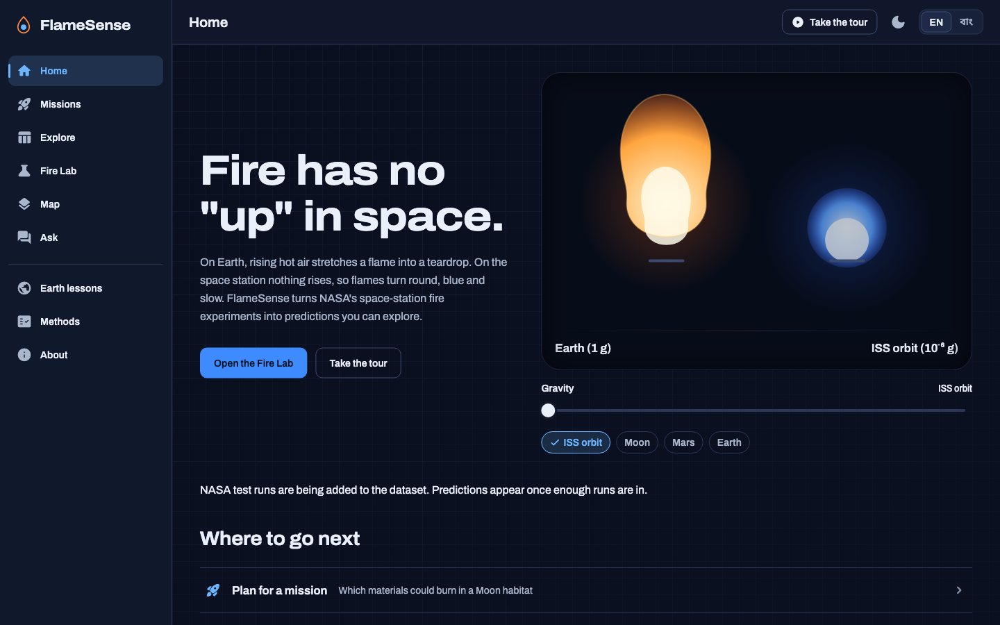
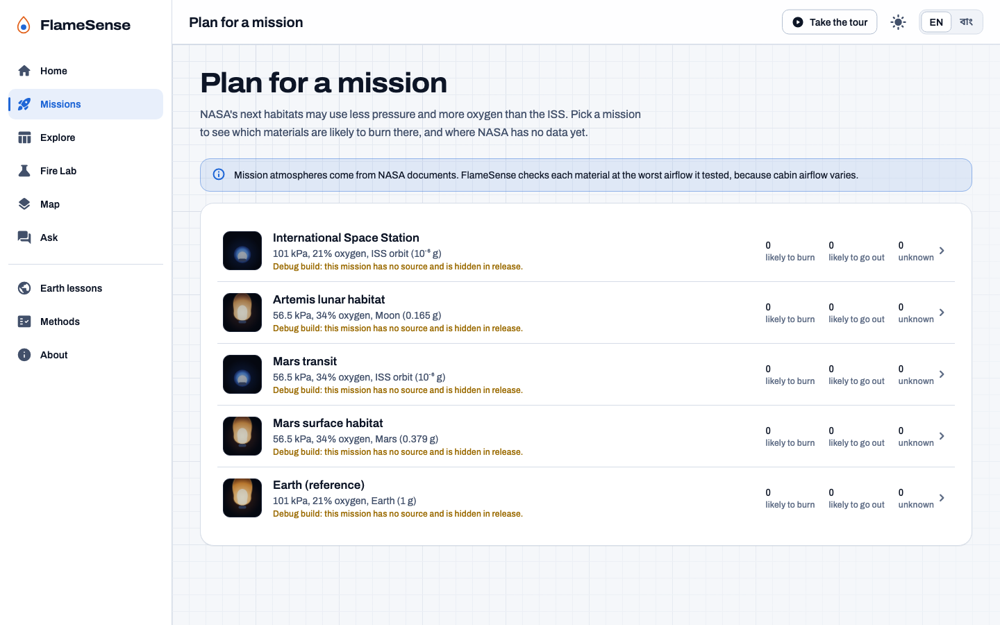
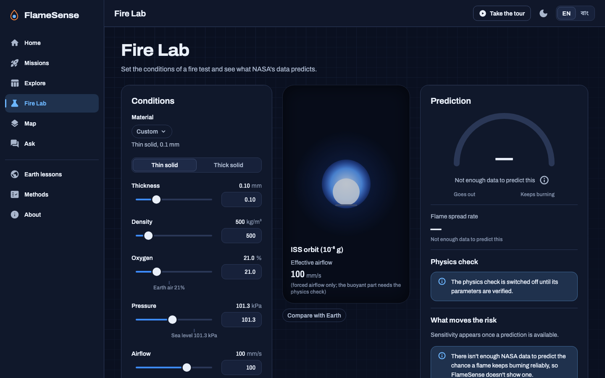
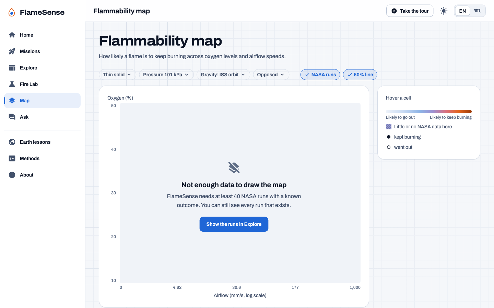

# FlameSense

**NASA is about to put astronauts in 34% oxygen on the Moon. FlameSense uses NASA's
space-station fire data to show which materials are likely to burn there, where the data runs
out, and which experiments NASA should run next.**

NASA Space Apps Challenge 2026, Rajshahi: *Flame in Freefall: AI-Powered Fire Safety Insights
from Microgravity Combustion Data.*

- Live app: https://flamesense.ehsanur.com (fallback https://flamesense.pages.dev) [VERIFY after deploy]
- 60-second judge tour: https://flamesense.ehsanur.com/?tour=1
- Videos: [VIDEO2_URL] (240 s) and [VIDEO3_URL] (30 s)

FlameSense is a research and education tool. It is not a certified fire-safety system and must
not be used for operational safety decisions. Not affiliated with or endorsed by NASA. Uses NASA
open data.

## Screenshots

| Home (dark) | Missions (light) |
|---|---|
|  |  |
| **Fire Lab (dark)** | **Flammability map (light)** |
|  |  |

Screenshots show the current dataset; pages show their "not enough data yet" states until NASA
runs are added. Regenerate with
`cd app && flutter test --update-goldens --dart-define=FS_SCREENSHOTS=true test/screenshots_test.dart`.

## What it does

| Feature | Page |
|---|---|
| **Gravity Twin**: an Earth flame and a flame at your gravity, from Earth to Mars, Moon and orbit | Home |
| **Mission Mode**: ISS, Artemis lunar habitat, Mars transit and Mars surface atmospheres; each material's worst-case chance of burning, data support and verdict | Missions |
| **Experiment Wishlist**: the five most informative untested conditions, NASA's planned tests when sourced, CSV test matrix | Missions |
| **Mission Fire Brief**: one-click PDF of a mission's materials, data gaps, wishlist and citations | Missions |
| **Data Explorer**: every run with filters, charts, CSV export and its NASA source | Explore |
| **Fire Lab**: set material, oxygen, pressure, airflow and gravity; see the chance a flame keeps burning, spread rate with an 80% range, physics check, data support and "what moves the risk"; compare with Earth | Fire Lab |
| **Flammability map**: oxygen × airflow heat map with NASA runs, the 50% line and hatching where data is thin | Map |
| **Ask the NASA papers**: answers only from NASA documents, every sentence cited | Ask |
| **Lessons for Earth**, **Methods** (data, models, validation, physics, limitations), **About** | |
| English and বাংলা, light and dark themes, keyboard and screen-reader support | Everywhere |

## How it works

```
 OFFLINE (laptop)                                         ONLINE (Cloudflare Pages)
 data/raw + data/manual ─► pipeline (Python) ─► runs ─┐   Flutter Web (static): every prediction
 (cited NASA runs)          clean, features, LightGBM ├─► runs in the browser from JSON assets
 corpus PDFs ─► chunks                                │   Pages Function /api/ask: BM25 over NASA
                                                      └─► documents + Claude API, KV rate limit
```

- One canonical table, one row per test run, each with its source file and citation.
- LightGBM models (chance of burning; 10th/50th/90th-percentile spread rate) trained with grouped
  cross-validation by test series, exported as JSON trees and evaluated in Dart (checked against
  LightGBM to 1e-9).
- A k-nearest-neighbour data-support index flags predictions far from any NASA run.
- A thin-fuel opposed-flow theory (de Ris, 1969) and the buoyant velocity act as a physics check,
  switched off until the parameters are sourced and signed off.

## NASA data used

See [`docs/DATA_SOURCES.md`](docs/DATA_SOURCES.md) and the Methods page in the app. [VERIFY: the
dataset table is filled by the lead before the hackathon.]

## Validation

From `app/assets/data/metrics.json` and [`docs/MODEL_CARD.md`](docs/MODEL_CARD.md). With the
current dataset no model is trained yet (both tasks need at least 40 usable runs), so the app
shows "not enough data" instead of a prediction. [VERIFY: replace with the metrics once real runs
are in.] Usability test results: [VERIFY: `data/manual/usability.csv`].

## Limitations

Small dataset; runs from one test series are not independent; predictions outside the tested
ranges, and at Moon or Mars gravity, are extrapolations; the physics check is a simplified theory
that over-predicts near extinction; not for operational use.

## Run locally

```bash
# Pipeline (Python 3.11+; on macOS LightGBM needs `brew install libomp`)
python3 -m venv pipeline/.venv && source pipeline/.venv/bin/activate
pip install -r pipeline/requirements.txt && pip install -e pipeline
python -m flamesense.cli all            # ingest → validate → clean → features → report → train → export → evaluate
python -m flamesense.cli corpus         # Ask documents → pipeline/out/corpus_chunks.json
bash scripts/sync_assets.sh             # copy exports into the app
pytest pipeline/tests -q

# App (Flutter 3.47 stable)
cd app && flutter pub get && flutter gen-l10n && flutter analyze && flutter test
flutter build web --release --no-web-resources-cdn && cd ..

# Ask API + site together (put ANTHROPIC_API_KEY in a local .dev.vars, never commit it)
npm --prefix functions-dev install && npm --prefix functions test
npx wrangler pages dev app/build/web    # http://localhost:8788

# Smoke test (Playwright with your installed Chrome)
npm --prefix scripts install && node scripts/smoke.mjs http://localhost:8788
```

Adding data: [`DATA_UPDATE.md`](DATA_UPDATE.md). Contributing: [`CONTRIBUTING.md`](CONTRIBUTING.md).

## Team

Team FlameSense, Rajshahi. Ehsanur: code, data and science checks; two team members:
registrations, videos, slides and usability testing. [VERIFY names per the under-18 rule.]

## License

Code: Apache-2.0 ([`LICENSE`](LICENSE)). Fonts: Archivo and Noto Sans Bengali, SIL Open Font
License 1.1 (`app/assets/fonts/LICENSES/`). Data: NASA open data, credited per source.

## AI disclosure

A coding agent (Claude Code) wrote the code under the lead's review; every prompt is listed in
[`docs/AI_USAGE.md`](docs/AI_USAGE.md). The Ask page uses the Claude API only over retrieved NASA
documents. Predictions come from LightGBM models trained on NASA data. No images or voices in the
app are AI-generated.
