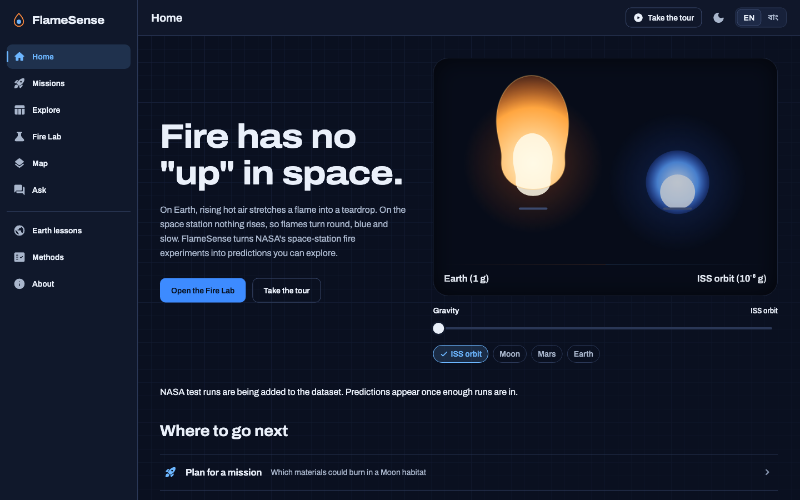
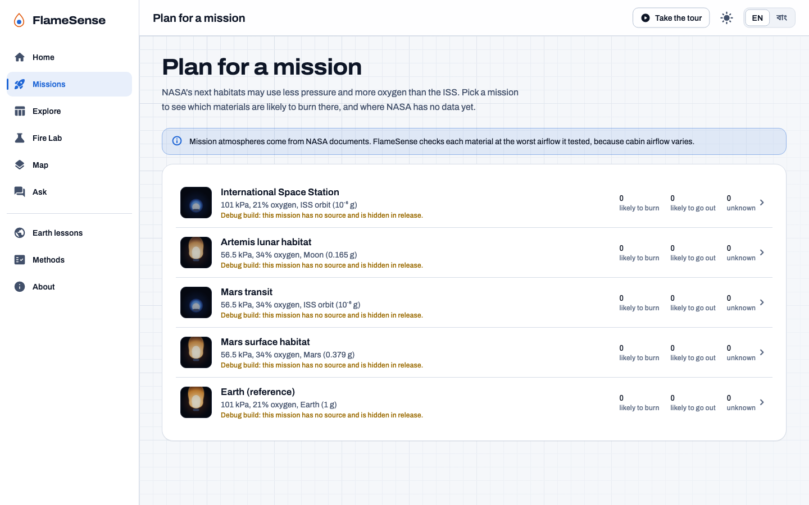
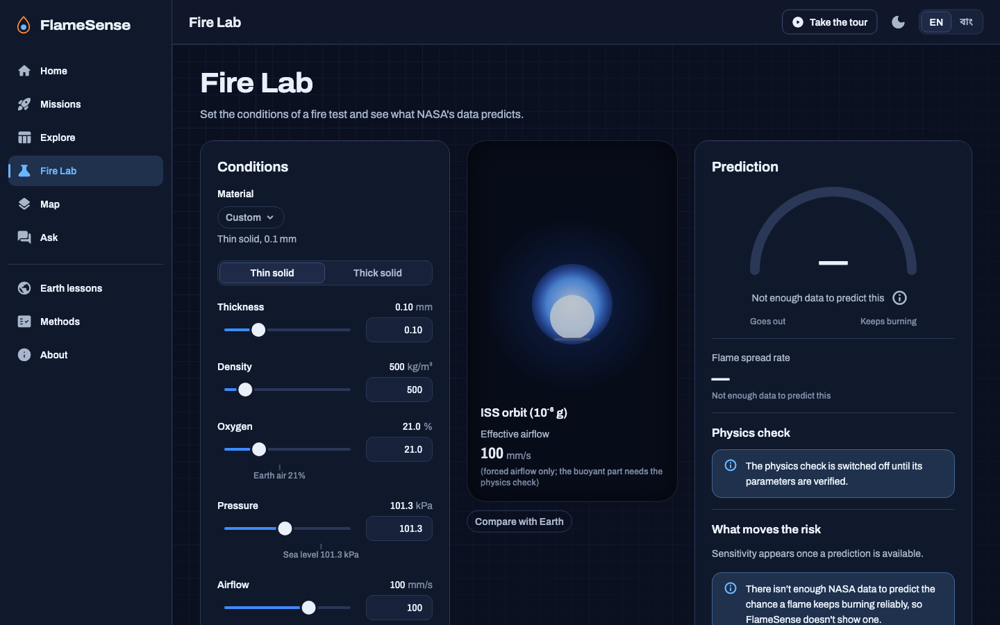
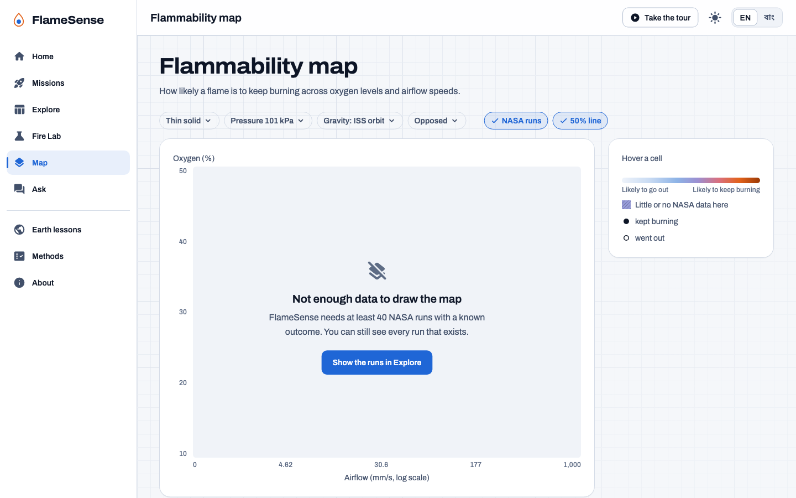

# FlameSense

**NASA is about to put astronauts in 34% oxygen on the Moon. FlameSense uses NASA's
space-station fire data to show which materials are likely to burn there, where the data runs
out, and which experiments NASA should run next.**

NASA Space Apps Challenge 2026, Rajshahi: *Flame in Freefall: AI-Powered Fire Safety Insights
from Microgravity Combustion Data.*

- Live app: https://flamesense.ehsanur.com (fallback https://flamesense.pages.dev) [VERIFY after deploy]
- 60-second judge tour: https://flamesense.ehsanur.com/?tour=1
- Videos: [VIDEO2_URL] (240 s) and [VIDEO3_URL] (30 s)

FlameSense is a research and education tool. It is not a certified fire-safety system and must
not be used for operational safety decisions. Not affiliated with or endorsed by NASA. Uses NASA
open data.

## Screenshots

| Home (dark) | Missions (light) |
|---|---|
|  |  |
| **Fire Lab (dark)** | **Flammability map (light)** |
|  |  |

Regenerate the screenshots with
`cd app && flutter test --update-goldens --dart-define=FS_SCREENSHOTS=true test/screenshots_test.dart`.

## What it does

| Feature | Page |
|---|---|
| **Gravity Twin**: an Earth flame and a flame at your gravity, from Earth to Mars, Moon and orbit | Home |
| **Mission Mode**: ISS, Artemis lunar habitat, Mars transit and Mars surface atmospheres; each material's worst-case chance of burning, data support and verdict | Missions |
| **Experiment Wishlist**: the five most informative untested conditions, NASA's planned tests when sourced, CSV test matrix | Missions |
| **Mission Fire Brief**: one-click PDF of a mission's materials, data gaps, wishlist and citations | Missions |
| **Data Explorer**: every run with filters, charts, CSV export and its NASA source | Explore |
| **Fire Lab**: set material, oxygen, pressure, airflow and gravity; see the chance a flame keeps burning, spread rate with an 80% range, physics check, data support and "what moves the risk"; compare with Earth | Fire Lab |
| **Flammability map**: oxygen × airflow heat map with NASA runs, the 50% line and hatching where data is thin | Map |
| **Ask the NASA papers**: answers only from NASA documents, every sentence cited | Ask |
| **Lessons for Earth** (Apollo 1, Apollo 13, Mir, NASA spinoffs; shown once approved), **Methods** (data, models, validation, physics, limitations), **About** | |
| Light and dark themes, keyboard and screen-reader support | Everywhere |

## How it works

```
 OFFLINE (laptop)                                         ONLINE (Cloudflare Pages + Functions)
 data/raw + data/manual ─► pipeline (Python) ─► runs ─┐   Flutter Web (static): every prediction
 (cited NASA runs)          clean, features, LightGBM ├─► runs in the browser from JSON assets
 corpus PDFs ─► chunks                                │   Suggested Ask answers use cached assets
                                                      └─► /api/ask Pages Function (KV rate limit)
```

- One canonical table, one row per test run, each with its source file and citation.
- LightGBM models (chance of burning; 10th/50th/90th-percentile spread rate) trained with grouped
  cross-validation by test series, exported as JSON trees and evaluated in Dart (checked against
  LightGBM to 1e-9).
- A k-nearest-neighbour data-support index flags predictions far from any NASA run.
- A thin-fuel opposed-flow theory (de Ris, 1969) and the buoyant velocity act as a physics check,
  switched off until the parameters are sourced and signed off.

## NASA data used

**Training data: 123 test runs** from 10 experiment series on 14 fuels (97 microgravity,
26 partial gravity). 127 rows were ingested; 4 exact duplicates were dropped and logged in
`app_meta.json`. Every row keeps its source file and citation.

| Source | Runs |
|---|---|
| BASS / BASS-II summary report, NASA/TM-20210011385 | 71 |
| Takahashi et al. 2026, partial-gravity aircraft tests (Proc. Combust. Inst., CC BY 4.0) | 26 |
| Saffire I–III, NTRS 20180005168 | 13 |
| Sharma et al. 2024, BASS hardware, confined flow (NASA co-authored, CC BY 4.0) | 5 |
| Saffire IV–V (Urban et al.) and Saffire VI preliminary results | 5 + 3 |

**Challenge resources and how each is used:**

| Resource | Where it appears |
|---|---|
| [PSI Data Repository: Combustion Science](https://psi.nasa.gov/physci/repo/search?q=combustion) | All 24 combustion investigations power Explore → "What NASA has tested" (1,991 table rows, 1,009 placed on the O₂ × pressure grid). BASS, BASS-II and Saffire I–III feed the models (run values taken from the NASA reports above). For every other investigation the app states why it can't train the solid-fuel models: no per-run outcome or rate, no O₂/pressure column, or a droplet/gas-jet fuel (FLEX, ACME CFI-G). |
| [NASA Combustion Science](https://www.nasa.gov/glenn/glenn-expertise-space-exploration/physical-sciences-program/combustion-science/), [Researcher's Guide to ISS Combustion Science](https://www.nasa.gov/missions/station/a-researchers-guide-to-combustion-science/) | In the Ask corpus (`pipeline/out/corpus_chunks.json`, 68 documents with 60 NTRS reports). |
| [Apollo 1](https://sma.nasa.gov/sma-disciplines/accllp/apollo-1), [Apollo 13](https://sma.nasa.gov/sma-disciplines/accllp/apollo-13), [Mir fire 1997](https://www.nasa.gov/history/25-years-ago-fire-aboard-space-station-mir/) | About → "Why fire safety in space matters"; Lessons for Earth (L1–L3); Ask corpus. |
| Spinoffs: [air tanks](https://spinoff.nasa.gov/node/9582), [fire detector](https://spinoff.nasa.gov/node/9407), [fire attire](https://spinoff.nasa.gov/node/9918) | Lessons for Earth (L4–L6); Ask corpus. |
| [ScienceCasts video](https://www.youtube.com/watch?v=W1oXykoz9zg) | Background only (video, no text to cite). |

Lessons are drafted in `data/manual/lessons_draft.md` and appear in release builds only after
the lead approves them. See also [`docs/DATA_SOURCES.md`](docs/DATA_SOURCES.md) and the Methods page.

## Validation

From `app/assets/data/metrics.json` and [`docs/MODEL_CARD.md`](docs/MODEL_CARD.md).

| Task | Rows / test series | Cross-validation | Result | Simple baseline |
|---|---|---|---|---|
| Flame keeps burning | 42 / 4 | GroupKFold(4) by test series | ROC-AUC 0.82, Brier 0.19, accuracy 69 % | Brier 0.35 |
| Spread rate | 45 / 2 | KFold(5) | MAE 0.16 mm/s, R² (log) 0.78, median error 26 % | MAE 0.26 mm/s |

Spread uses only two independent test series, so its scores may be optimistic, and its 80 %
range covers 51 % of results (too narrow). The app gives a number only inside the range where
NASA saw both outcomes (O₂ 16.9–22.1 %, 100–101.3 kPa, airflow 22–470 mm/s, orbit); elsewhere
it shows "Outside NASA's tested range". Usability testing has not been run yet, so the app hides that section until real results exist.

## Limitations

Small dataset; runs from one test series are not independent; predictions outside the tested
ranges, and at Moon or Mars gravity, are extrapolations; the physics check is a simplified theory
that over-predicts near extinction; not for operational use.

## Run locally

One command (from the repo root): `bash scripts/dev.sh` runs the data pipeline, builds the app and
serves the site with the Ask API at http://localhost:8788. Use `bash scripts/dev.sh --quick` for a
Flutter debug run in Chrome with hot reload (no Ask API). Step by step:

```bash
# Pipeline (Python 3.11+; on macOS LightGBM needs `brew install libomp`)
python3 -m venv pipeline/.venv && source pipeline/.venv/bin/activate
pip install -r pipeline/requirements.txt && pip install -e pipeline
python -m flamesense.cli all            # ingest → validate → clean → features → report → train → export → evaluate
python -m flamesense.cli corpus         # Ask documents → pipeline/out/corpus_chunks.json
bash scripts/sync_assets.sh             # copy exports into the app
pytest pipeline/tests -q

# App (Flutter 3.47 stable)
cd app && flutter pub get && flutter gen-l10n && flutter analyze && flutter test
flutter build web --release --no-web-resources-cdn && cd ..

# Ask API + site together (put GEMINI_API_KEY and GROQ_API_KEY in a local .dev.vars, never commit it)
npm --prefix functions-dev install && npm --prefix functions test
npx wrangler pages dev app/build/web    # http://localhost:8788

# Smoke test (Playwright with your installed Chrome)
npm --prefix scripts install && node scripts/smoke.mjs http://localhost:8788
```

Adding data: [`DATA_UPDATE.md`](DATA_UPDATE.md). Contributing: [`CONTRIBUTING.md`](CONTRIBUTING.md).

## Deploy (Cloudflare Pages + Functions)

The static app and the `/api/ask` function deploy together to Cloudflare Pages. A static-only
host can't run `/api/ask`. One-time setup, from the repo root:

```bash
npx wrangler login
npx wrangler pages project create flamesense --production-branch main
npx wrangler kv namespace create RATE_KV        # paste the id into wrangler.toml [[kv_namespaces]]
npx wrangler pages secret put GEMINI_API_KEY --project-name flamesense   # free key from Google AI Studio
npx wrangler pages secret put GROQ_API_KEY --project-name flamesense     # free key from console.groq.com (fallback)
```

Then, from a clean tree:

```bash
bash scripts/deploy.sh --preview   # https://preview.flamesense.pages.dev + smoke test
bash scripts/deploy.sh             # production from a pushed main + smoke test
```

`scripts/deploy.sh` runs `scripts/build_all.sh` (pipeline, analyze, test, web build, secret scan),
then `wrangler pages deploy app/build/web` and `scripts/smoke.mjs` against the deployed URL.
Pages serves `index.html` for app routes. Every `/api/*` response is JSON, and unknown API paths
return a JSON 404. Without the secret, `/api/ask` answers 503 JSON right away and the app shows
"Free-form questions aren't available right now" while the saved answers keep working.

When Google's free tier is used up or the model is overloaded, `/api/ask` answers 429
`{"error":"upstream_busy","retry_after_s":N}` and the app says how long to wait. One key is
used; keys are never rotated to get around quota.

**Static host + Cloudflare API.** The live site can stay on a static host (Namecheap) and still
answer free-form questions by building with the API on Cloudflare Pages:
`ASK_API_BASE=https://flamesense.pages.dev bash scripts/build_all.sh`. The function's
`ALLOWED_ORIGINS` already includes `https://flamesense.ehsanur.com`.

Custom domain: Cloudflare dashboard → Workers & Pages → flamesense → Custom domains → add
`flamesense.ehsanur.com`, then at the DNS host for `ehsanur.com` set
`CNAME flamesense → flamesense.pages.dev` (no other A/AAAA/CNAME record for `flamesense`).

Pages that aren't ready (missing or invalid data) are hidden automatically by
`app/lib/core/features.dart`: no nav item, no Home link, no tour step, and deep links go Home.

## Team

Team FlameSense, Rajshahi. Ehsanur: code, data and science checks; two team members:
registrations, videos, slides and usability testing. [VERIFY names per the under-18 rule.]

## License

Code: Apache-2.0 ([`LICENSE`](LICENSE)). Fonts: Archivo and Noto Sans Bengali, SIL Open Font
License 1.1 (`app/assets/fonts/LICENSES/`). Data: NASA open data, credited per source.

## AI disclosure

A coding agent (Claude Code) wrote the code under the lead's review; every prompt is listed in
[`docs/AI_USAGE.md`](docs/AI_USAGE.md). The Ask page uses the Google Gemini API (free tier, model
`gemini-flash-latest`), falling back to Groq (free tier, `openai/gpt-oss-120b`) when Gemini is
busy or out of quota, only over retrieved NASA documents; its 6 suggested questions use saved
answers. Predictions come from LightGBM models trained on NASA data. No images or voices in the
app are AI-generated.
