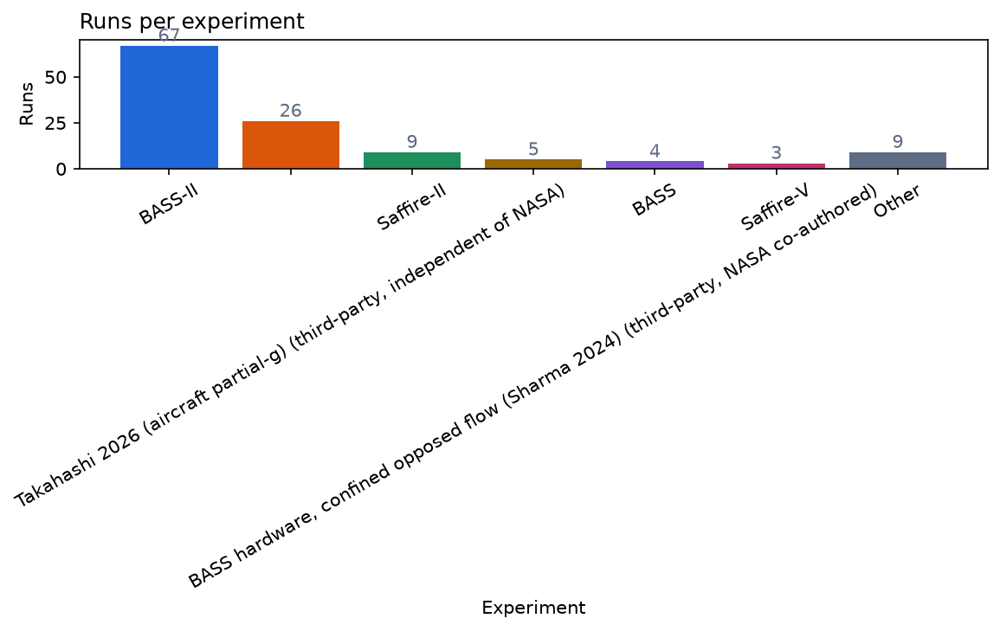
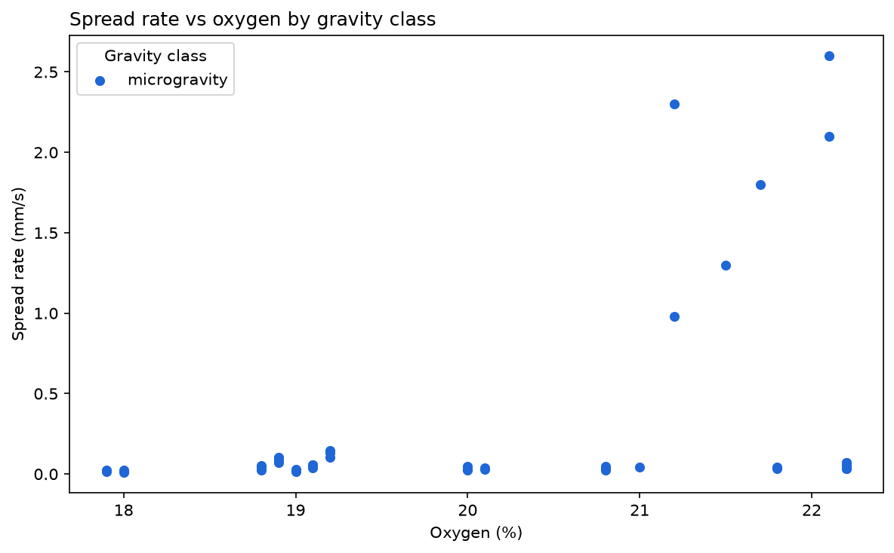
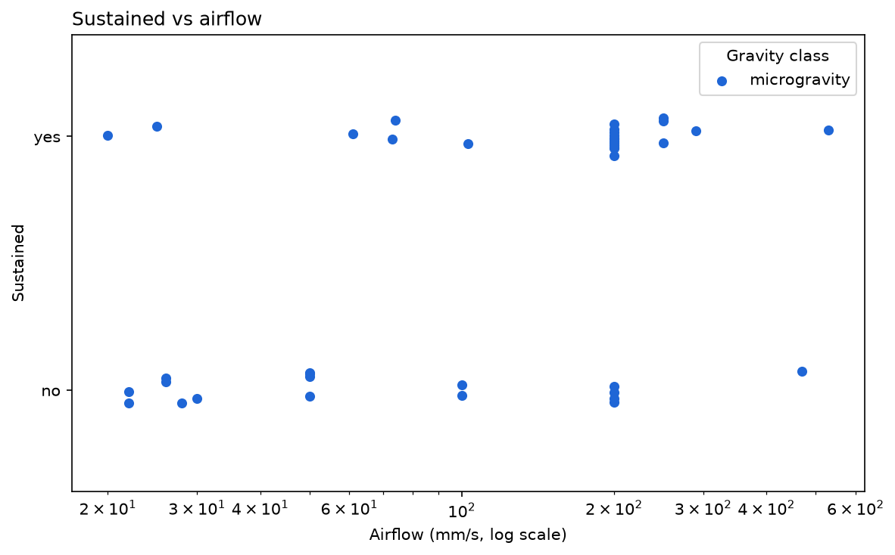
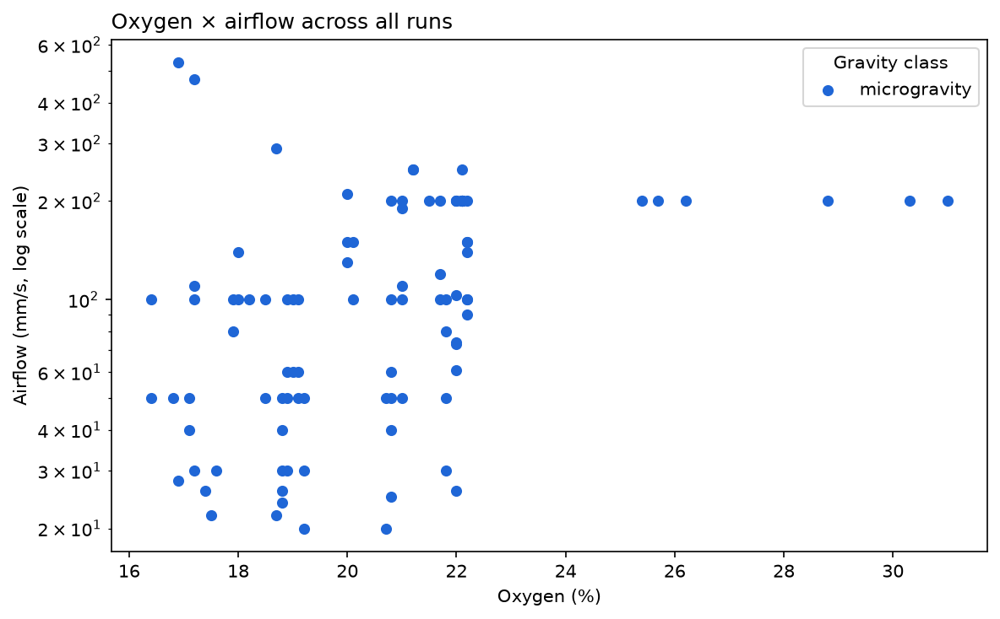
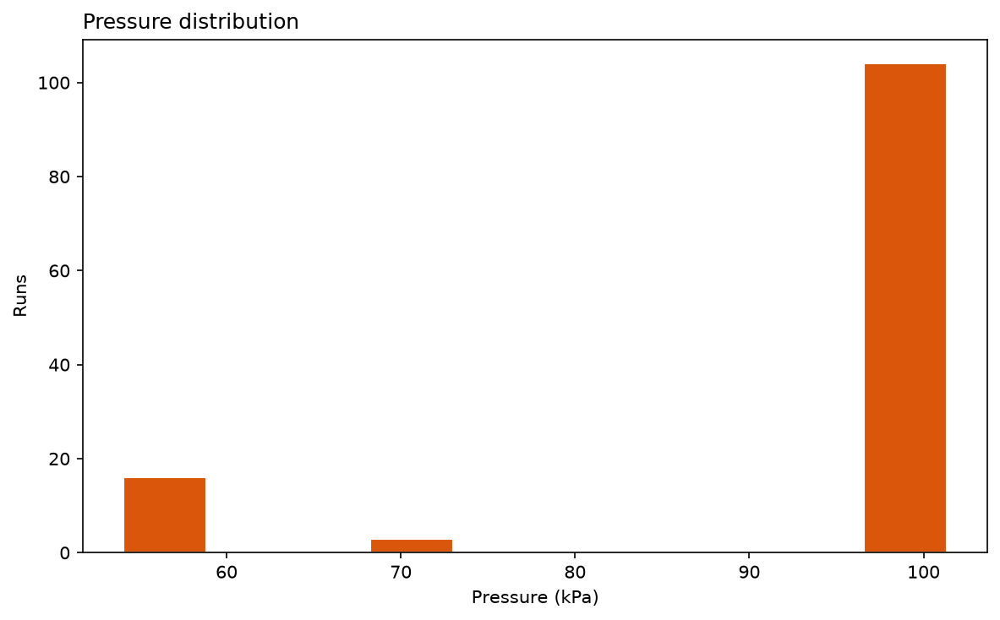

# FlameSense — Data Report

Generated: 2026-11-13T03:46:08+00:00 (UTC)

## Key data facts

- 123 runs (92 NASA, 0 partner agency, 31 third-party) from 10 experiments across 14 materials.
- 97 runs in microgravity, 26 in partial gravity, 0 at Earth gravity.
- Spread rate: 0.012–2.6 mm/s (median 0.047 mm/s) across 45 measured runs.
- Oxygen ranges 15–31%; pressure 54.1–101 kPa.
- 41 runs state whether the flame kept burning; 58.5% of them did.

## Summary

- **Total runs:** 123
- **Experiments:** 10
- **Materials:** 14

## Runs by source type

| Value | Runs |
|---|---|
| nasa_report | 92 |
| third_party | 31 |
| nasa_psi | 0 |
| partner_agency | 0 |

## Runs by gravity class

| Value | Runs |
|---|---|
| microgravity | 97 |
| partial | 26 |
| earth | 0 |

## Runs by experiment

| Value | Runs |
|---|---|
| BASS-II | 67 |
| Takahashi 2026 (aircraft partial-g) (third-party, independent of NASA) | 26 |
| Saffire-II | 9 |
| BASS hardware, confined opposed flow (Sharma 2024) (third-party, NASA co-authored) | 5 |
| BASS | 4 |
| Saffire-V | 3 |
| Saffire-VI | 3 |
| Saffire-I | 2 |
| Saffire-III | 2 |
| Saffire-IV | 2 |

## Runs by model use

Sustain model trains on 42 runs; spread model on 45. The rows below do not overlap and sum to 123.

| Model use | Runs |
|---|---|
| Sustain model only | 36 |
| Spread model only | 39 |
| Both models | 6 |
| Not used by a model | 42 |

## Data provenance

| Source type | Authorship | Source | Experiments | Runs | Merged duplicates |
|---|---|---|---|---|---|
| nasa_report | NASA | [NASA/TM-20210011385, Burning and Suppression of Solids-II (BASS-II) Summary Report (NTRS 20210011385).](https://ntrs.nasa.gov/citations/20210011385) | BASS, BASS-II | 71 | 3 |
| third_party | Independent of NASA | [Takahashi S., Hanamoto K., Kurauchi Y., Namura H., Kobayashi Y. (2026). Downward flame spread of thermally thin solid materials in partial-gravity environments: evaluation of flammability in space habitats. Proceedings of the Combustion Institute 42, 106097. CC BY 4.0.](https://doi.org/10.1016/j.proci.2026.106097) | Takahashi 2026 (aircraft partial-g) (third-party, independent of NASA) | 26 | 0 |
| nasa_report | NASA | [Saffire: A Novel Approach to Study of Spacecraft Fire Safety Using Un-Manned Spacecraft, NTRS 20180005168, Table 1 pp.30-31.](https://ntrs.nasa.gov/citations/20180005168) | Saffire-I, Saffire-II, Saffire-III | 13 | 0 |
| third_party | NASA co-authored | [Sharma A., Li Y., Liao Y.-T. T., Ferkul P. V., Johnston M. C., Bunnell C. (2024). Effects of Confinement on Opposed-Flow Flame Spread over Cellulose and Polymeric Solids in Microgravity. Microgravity Science and Technology 36:20, Table 1 p.5. CC BY 4.0.](https://doi.org/10.1007/s12217-024-10106-y) | BASS hardware, confined opposed flow (Sharma 2024) (third-party, NASA co-authored) | 5 | 1 |
| nasa_report | NASA | [Urban D. et al., Fire Safety Implications of Preliminary Results from Saffire IV and V Experiments on Large Scale Spacecraft Fires, ICES-2021-266 (NTRS 20210011521).](https://ntrs.nasa.gov/citations/20210011521) | Saffire-IV, Saffire-V | 5 | 0 |
| nasa_report | NASA | [Preliminary Results from the Saffire VI Experiment, ICES-2024-365 (NTRS 20240002981).](https://ntrs.nasa.gov/citations/20240002981) | Saffire-VI | 3 | 0 |

Rows ingested: 127; dropped as exact duplicates: 4; runs kept: 123.

| Dropped run_id | Duplicate of | Reason |
|---|---|---|
| bassii_t71:GMT216-T26 | bassii_t71:GMT216-T25 | exact duplicate on DUP_KEY_COLUMNS (PLAN.md Phase 3 step 1b) |
| bassii_t71:GMT216-T28b | bassii_t71:GMT216-T28a | exact duplicate on DUP_KEY_COLUMNS (PLAN.md Phase 3 step 1b) |
| bassii_t71:GMT216-T29 | bassii_t71:GMT216-T27 | exact duplicate on DUP_KEY_COLUMNS (PLAN.md Phase 3 step 1b) |
| third_party_sharma2024:T1-4 | third_party_sharma2024:T1-1 | exact duplicate on DUP_KEY_COLUMNS (PLAN.md Phase 3 step 1b) |

## Missing data (%)

| Column | Missing % |
|---|---|
| run_id | 0.0 |
| group_id | 0.0 |
| experiment | 0.0 |
| platform | 0.0 |
| gravity_g | 0.0 |
| fuel_name | 0.0 |
| fuel_class | 0.0 |
| fuel_thickness_mm | 39.8 |
| fuel_density_kg_m3 | 100.0 |
| o2_mole_fraction | 0.0 |
| pressure_kpa | 0.0 |
| diluent | 100.0 |
| flow_velocity_mm_s | 21.1 |
| flow_direction | 21.1 |
| ignited | 65.9 |
| sustained | 66.7 |
| flame_spread_rate_mm_s | 63.4 |
| burning_rate_k_mm2_s | 100.0 |
| extinction_reason | 93.5 |
| source_id | 0.0 |
| source_file | 0.0 |
| source_citation | 0.0 |
| source_url | 0.0 |
| source_type | 0.0 |
| quality_flag | 0.0 |
| notes | 0.0 |
| log10_gravity | 0.0 |
| o2_partial_kpa | 0.0 |
| log10_flow | 21.1 |
| areal_density_kg_m2 | 100.0 |
| fuel_class__thick_solid | 0.0 |
| fuel_class__thin_solid | 0.0 |
| flow_direction__concurrent | 0.0 |
| flow_direction__opposed | 0.0 |

## Numeric column statistics

| Column | Min | Median | Max |
|---|---|---|---|
| gravity_g | 1e-06 | 1e-06 | 0.375 |
| fuel_thickness_mm | 0.12 | 2 | 10 |
| fuel_density_kg_m3 | – | – | – |
| o2_mole_fraction | 0.15 | 0.201 | 0.31 |
| pressure_kpa | 54.1 | 101 | 101 |
| flow_velocity_mm_s | 20 | 100 | 530 |
| flame_spread_rate_mm_s | 0.012 | 0.047 | 2.6 |
| burning_rate_k_mm2_s | – | – | – |
| log10_gravity | -6 | -6 | -0.426 |
| o2_partial_kpa | 8.47 | 19.3 | 22.5 |
| log10_flow | 1.32 | 2 | 2.73 |
| areal_density_kg_m2 | – | – | – |

## Charts

### Runs per experiment

### Spread rate vs oxygen by gravity class

### Sustained vs airflow

### Oxygen × airflow across all runs

### Pressure distribution

